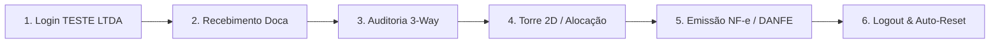

# 🎓 ROTEIRO DE APRENDIZAGEM PRÁTICA (GADAP ACADEMY)
> **Kit de Boas-Vindas & Capacitação Rápida:** Continuidade prática do `MANUAL_DE_MIGRACAO_E_IMPLANTACAO_GADAP.md`.  
> **Laboratório Prático:** Todas as atividades deste roteiro devem ser executadas na **empresa TESTE LTDA** (`teste@teste` / `teste`), garantindo liberdade total de aprendizado com reinicialização automática dos dados ao sair.

---

## 🎯 Objetivo da Formação
Capacitar novos gestores, operadores e conferentes em **menos de 45 minutos**, simulando o fluxo logístico real de ponta a ponta: do recebimento de uma carga importada até a emissão fiscal de retorno e conciliação contábil.

---

## 🚀 Trilha de Exercícios Práticos

---

### 📝 Exercício 1: Acesso ao Laboratório Sem Travas
1. Abra a tela de login (`/login`).
2. Clique no atalho dourado **"Ambiente Academy (TESTE LTDA)"** ou preencha:
   - **E-mail:** `teste@teste`
   - **Senha:** `teste`
3. Observe que o topo do sistema exibirá o aviso dourado:  
   *`Empresa TESTE LTDA (Modo Demonstração Academy • Sem Travas)`*.
4. **Desafio:** Navegue por pelo menos 3 menus de departamentos diferentes (ex: *Torre 2D*, *Fiscal Emissão* e *Folha de Pagamento*) para comprovar o acesso livre.

---

### 📝 Exercício 2: Conferência Cega e Registro de Avaria na Doca
1. No menu superior ou lateral, acesse **Doca • Recebimento (PWA)** (`/doca/recebimento`).
2. Digite o documento simulado: `DI-2026/999-TESTE`.
3. Selecione o depositante: `Demo Tech S.A.`.
4. **Simulação de Falta:** O fiscal declara 100 caixas, mas conte fisicamente apenas **98 volumes**.
5. **Simulação de Avaria:** Marque a opção de 2 caixas amassadas e tire/anexe uma foto de teste.
6. Adicione o serviço spot: `Aplicação de Filme Stretch (2 paletes)`.
7. Clique em **"Confirmar Recebimento"**.
8. **Resultado Esperado:** O sistema gera o Termo de Entrada com quarentena automática para as 2 unidades divergentes.

---

### 📝 Exercício 3: Auditoria 3-Way Match & Liberação Fiscal
1. Acesse **Torre & Operações > Auditoria 3-Way Match** (`/dashboard/auditoria`).
2. Localize a carga recebida com status `QUARANTINE`.
3. Veja o confronto: *Documento: 100 | Doca: 98 | Divergência: -2*.
4. Clique em **"Auditar e Justificar Divergência"**.
5. Insira a justificativa: *"Mercadoria avariada durante transporte marítimo - Termo de Avaria Lavrado"*.
6. Clique em **"Liberar Lote Aprovado"**.
7. **Resultado Esperado:** O lote é promovido para `STORED` e fica disponível para alocação no armazém.

---

### 📝 Exercício 4: Alocação e Consulta na Torre 2D
1. Acesse **Torre de Controle 2D** (`/dashboard/torre-controle`).
2. Localize a **Rua 01** no mapa de calor interativo.
3. Clique em uma posição verde (Livre), por exemplo `RUA01-P02-N01`.
4. Verifique o pop-up com as dimensões máximas permitidas (1.200 kg / 2.10m).
5. O palete recebido no exercício anterior agora consta alocado na posição correspondente.

---

### 📝 Exercício 5: Emissão Direct-to-SEFAZ e Impressão de DANFE
1. Acesse **Controladoria & Billing > Emissão Direct-to-SEFAZ** (`/dashboard/fiscal/emissao`).
2. Mantenha o seletor em modo **Homologação**.
3. Tipo de Nota: `NFE_RETORNO (Retorno de Armazenagem)`.
4. CFOP: `5906 - Retorno de mercadoria depositada em armazém geral`.
5. Valor da Mercadoria: `R$ 45.200,00`.
6. Clique no botão azul **"Emitir Documento (Direct-to-SEFAZ)"**.
7. Aguarde a validação do certificado A1 e o retorno da SEFAZ com status `cStat: 100 - Autorizado o uso da NF-e`.
8. Clique em **"Imprimir DANFE"** para visualizar o PDF oficial com o código de barras, chave de acesso e canhoto de entrega.
9. Clique em **"Baixar Pacote do Contador (.ZIP)"** e veja os XMLs e PDFs empacotados.

---

### 📝 Exercício 6: Exportação de Relatório com Marca D'Água LGPD
1. Acesse **Gestão, RH & Qualidade > Central Relatórios Excel** (`/dashboard/relatorios/exportacao`).
2. Clique no extrato **"DRE Detalhado da Operação"** ou **"Extrato de Movimentação"**.
3. O arquivo `.xlsx` será baixado em seu computador.
4. Abra o arquivo no Excel ou visualizador:
   - Observe o cabeçalho oficial com o nome da empresa e CNPJ.
   - Observe o rodapé contendo o **Hash Criptográfico SHA-256 e o carimbo LGPD de rastreabilidade**.

---

### 📝 Exercício 7: Finalização e Auto-Reset dos Dados
1. No canto inferior esquerdo da barra lateral, clique no ícone vermelho de **Logout** (porta de saída).
2. O sistema executará a limpeza em memória da empresa **TESTE LTDA**.
3. Faça login novamente com `teste@teste` / `teste`.
4. **Verificação de Sucesso:** Todo o estoque, pedidos e notas emitidas durante sua sessão de treino retornaram ao estado inicial padrão, deixando o laboratório 100% pronto para o próximo colaborador.

---

### 🏆 Parabéns!
Ao concluir este roteiro, você estará apto a operar as principais ferramentas logísticas, tributárias e operacionais do ecossistema GADAP Armazém.

